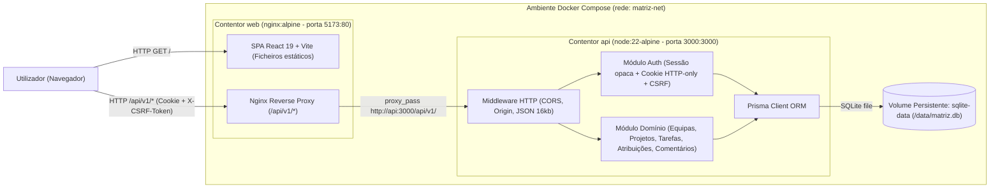

# Matriz — Arquitetura e Stack do MVP

## 1. Objetivo e estado da decisão

Este documento descreve a arquitetura do MVP da Matriz, cujo âmbito funcional confirmado é organizar projetos por equipas, gerir e consultar tarefas, atribuir responsáveis, registar comentários e acompanhar o progresso.

**Decisão arquitetural:** adotar um **monólito modular** organizado num monorepo `npm workspaces` (`@matriz/web` e `@matriz/api`). A stack aprovada e implementada é TypeScript, React 19 com Vite 8, Node.js 22 com Express 5 e SQLite com Prisma 6, com containerização via Docker e orquestração por Docker Compose (`compose.yaml`). Esta escolha não introduz serviços externos.

## 2. Comparação de estilos arquiteturais

| Arquitetura | Vantagens | Desvantagens | Adequação ao MVP |
|---|---|---|---|
| Monólito | Simples de desenvolver, executar e disponibilizar; comunicação direta entre componentes. | Sem limites explícitos, o código pode ficar fortemente acoplado e mais difícil de evoluir. | Viável para começar, mas não explicita fronteiras entre as áreas do domínio. |
| Monólito modular | Mantém uma única aplicação e disponibilização simples, com módulos e responsabilidades bem delimitados. | Exige disciplina para preservar os limites entre módulos; não permite escalar ou disponibilizar cada módulo de forma independente. | **Escolhido:** equilibra simplicidade operacional com organização clara para autenticação, equipas, projetos, tarefas, atribuições e comentários. |
| Microservices | Permite disponibilizar e escalar serviços de forma independente, com autonomia por área. | Acrescenta comunicação de rede, consistência distribuída, observabilidade e esforço operacional. | Não justificado pelo âmbito atual nem por requisitos de escala, disponibilidade ou autonomia de equipas. |

## 3. Diagrama de Arquitetura (Mermaid)

## 4. Componentes e responsabilidades

| Componente | Localização | Responsabilidades |
|---|---|---|
| **Interface da aplicação (Frontend)** | `apps/web/src/` | SPA React/Vite para autenticação, painel com contagens por estado, pesquisa e gestão de projetos, listagem/filtragem/CRUD de tarefas, gestão de responsáveis elegíveis e comentários; apresenta estados de carregamento, vazio e erro. |
| **Camada HTTP e Middleware** | `apps/api/src/app.ts`, `apps/api/src/http/middleware.ts` | Validação de origem (`WEB_ORIGIN`), cabeçalhos CORS com credenciais, limite de payload JSON (`16kb`) e tratamento uniforme de erros (`400`, `413`, `500`). |
| **Módulo de autenticação e sessão** | `apps/api/src/auth/` | Login (`POST /api/v1/auth/login`), perfil (`GET /api/v1/auth/me`) e logout (`POST /api/v1/auth/logout`). Persiste apenas o hash SHA-256 do token de sessão e do token CSRF no SQLite, emite cookie `matriz_session` (`HttpOnly`, `SameSite=Lax`, validade de 8h) e valida `X-CSRF-Token` em todas as mutações. Passwords armazenadas com `scrypt`. |
| **Módulo de domínio (Projetos, Tarefas, Atribuições, Comentários, Painel)** | `apps/api/src/domain/` | Implementa as rotas sob `/api/v1`, validação pura de títulos (`validateTaskTitle` em `task-title.ts`), regras de autorização por pertença à equipa e propriedade do projeto (`ownerId`), contagens por estado no painel (`/api/v1/dashboard`) e proteção contra eliminação com dependências (`409 Conflict`). |
| **Persistência e Seed** | `apps/api/prisma/`, `apps/api/src/database/` | Schema relacional SQLite gerido pelo Prisma (`users`, `teams`, `team_memberships`, `projects`, `tasks`, `task_assignments`, `comments`, `sessions`), 4 migrations versionadas e seed explícita de dados de demonstração (`seed.ts`). |

## 5. Containerização e execução com Docker Compose

A aplicação é empacotada em dois contentores multi-stage orquestrados por `compose.yaml`:

1. **`api` (`apps/api/Dockerfile`):**
   - **Stage 1 (`build`):** Base `node:22-alpine`, instala dependências dos workspaces (`npm ci`), gera o cliente Prisma e compila TypeScript (`npm run build -w @matriz/api`).
   - **Stage 2 (`runtime`):** Base `node:22-alpine`, inclui apenas o código compilado (`dist/`), `node_modules` necessários e schema/migrations Prisma. No arranque executa `npm run db:deploy -w @matriz/api && npm run start -w @matriz/api` na porta `3000`.
   - **Persistência:** Monta o volume nomeado `sqlite-data` em `/data` (`DATABASE_URL=file:/data/matriz.db`).
   - **Healthcheck:** Verifica periodicamente `http://127.0.0.1:3000/api/v1/auth/me`.

2. **`web` (`apps/web/Dockerfile` e `apps/web/nginx.conf`):**
   - **Stage 1 (`build`):** Base `node:22-alpine`, compila a aplicação React/Vite (`npm run build -w @matriz/web`) com `VITE_API_URL=/api/v1`.
   - **Stage 2 (`runtime`):** Base `nginx:alpine`, serve os ficheiros estáticos na porta `80` (mapeada por omissão para `5173` no host) e encaminha pedidos `/api/v1/` para `${API_UPSTREAM}/api/v1/` (`http://api:3000` na rede `matriz-net`).
   - **Ordem de arranque e Healthcheck:** Aguarda que o serviço `api` atinja o estado `healthy` (`depends_on` com `condition: service_healthy`) e verifica `http://127.0.0.1:80/` com `wget`.

## 6. Limites e questões em aberto

- Os módulos de domínio partilham o mesmo processo Node.js/Express e a mesma base SQLite; não são serviços distribuídos independentes.
- A política de autorização implementada baseia-se na pertença à equipa (consulta de projetos e gestão de tarefas, atribuições e comentários) e na propriedade do projeto (`ownerId`, para editar e eliminar o projeto).
- A eliminação de projetos com tarefas ou de tarefas com comentários/atribuições é recusada com `HTTP 409 Conflict` e chaves estrangeiras `RESTRICT`.
- **Questões funcionais pendentes de confirmação pelo formador** (registadas em `docs/constraints.md`, não inferidas no código):
  1. Pode um utilizador pertencer a mais do que uma equipa? (O schema suporta N:M em `team_memberships`, mas a regra de negócio aguarda validação.)
  2. Pode um projeto ser transferido para outra equipa após a criação? (Atualmente `PATCH /api/v1/projects/{projectId}` apenas permite atualizar `name` e `description`.)

## 7. Revisão da decisão

Reavaliar a arquitetura caso surjam requisitos confirmados de concorrência elevada de escrita (que justifiquem migrar de SQLite para PostgreSQL) ou de escalabilidade independente entre módulos.
