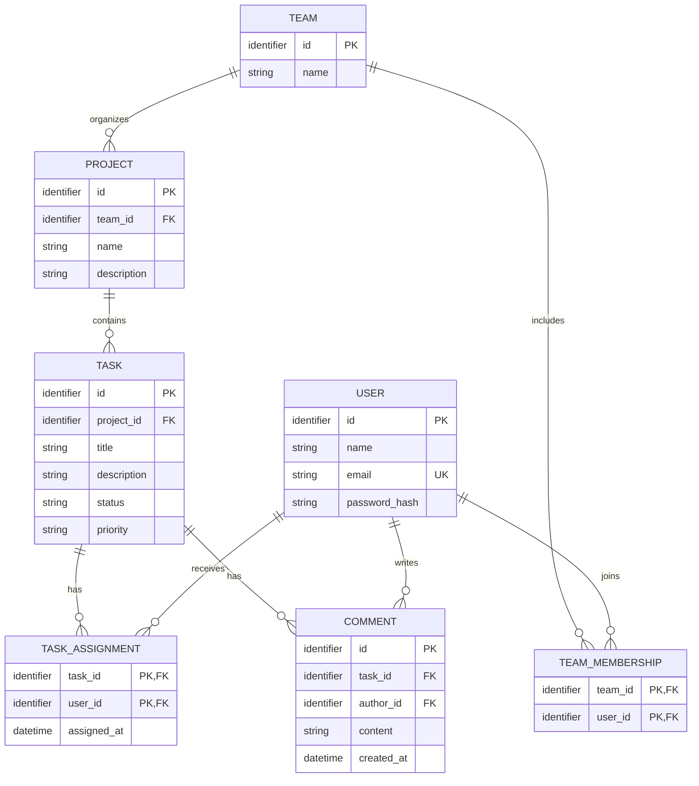

# Matriz — Modelo de Dados e Diagrama ER

## 1. Objetivo e estado

Este modelo conceptual consolida o âmbito da Ficha 03 com o MVP inicial. Os identificadores e tipos da tabela são conceptuais, salvo os enums de estado/prioridade escolhidos para a ficha; a secção do esquema físico descreve a implementação Prisma/SQLite.

Decisões registadas para o planeamento: cada projeto pertence a uma equipa; estados `TODO`, `IN_PROGRESS`, `DONE`; prioridades `LOW`, `MEDIUM`, `HIGH`. As regras de autorização e elegibilidade de responsáveis continuam pendentes de validação com o formador.

## 2. Entidades e atributos

| Entidade | Atributos conceptuais | Identificadores e regras |
|---|---|---|
| **USER** (Utilizador) | `id`, `name`, `email`, `password_hash` | `id` é PK. `email` identifica a conta e deve ser único. `password_hash` guarda apenas um hash, nunca a palavra-passe em texto simples; não é exposto pela API. |
| **TEAM** (Equipa) | `id`, `name` | `id` é PK. Campos mínimos propostos; gestão de equipas não faz parte das operações especificadas nesta ficha. |
| **TEAM_MEMBERSHIP** (Membro de equipa) | `team_id`, `user_id` | PK composta (`team_id`, `user_id`); FKs para `TEAM` e `USER`. Relação associativa proposta para representar utilizadores em equipas. Se um utilizador pode pertencer a várias equipas aguarda confirmação. Papel/permissão não é atributo definido. |
| **PROJECT** (Projeto) | `id`, `team_id`, `name`, `description` | `id` é PK; `team_id` é FK obrigatória para `TEAM`. Cada projeto pertence a uma única equipa, conforme decisão da Ficha 03. |
| **TASK** (Tarefa) | `id`, `project_id`, `title`, `description`, `status`, `priority` | `id` é PK; `project_id` é FK obrigatória. `status` ∈ `{TODO, IN_PROGRESS, DONE}`; `priority` ∈ `{LOW, MEDIUM, HIGH}`. |
| **TASK_ASSIGNMENT** (Responsável) | `task_id`, `user_id`, `assigned_at` | PK composta (`task_id`, `user_id`); FKs para `TASK` e `USER`. A chave composta impede duplicar a mesma atribuição. `assigned_at` é definido pelo sistema. |
| **COMMENT** (Comentário) | `id`, `task_id`, `author_id`, `content`, `created_at` | `id` é PK; `task_id` e `author_id` são FKs obrigatórias. Autor vem do utilizador autenticado e `created_at` é definido pelo sistema. |

`name`, `title`, descrições e comprimentos ainda necessitam de validação de regras de campo. O esquema físico inicial usa Prisma/SQLite, identificadores CUID, timestamps geridos pela aplicação e tabelas em `snake_case`; as migrations versionadas ficam em `apps/api/prisma/migrations/`.

Como SQLite não aplica enums Prisma nativos, `TASK.status` e `TASK.priority` são armazenados como texto e limitados por `CHECK` na migration. O cliente Prisma é gerado automaticamente após a instalação das dependências. As relações usam restrição de eliminação, sem cascade, como salvaguarda para não apagar dados dependentes enquanto a política de eliminação não for validada. Esta escolha técnica não substitui a decisão funcional pendente.

## 3. Relações e cardinalidades

| Relação | Cardinalidade | Interpretação / estado |
|---|---|---|
| `TEAM` — `PROJECT` | 1:N | Cada projeto tem exatamente uma equipa; a equipa pode não ter projetos ou ter vários. Decisão registada para a Ficha 03. |
| `TEAM` — `TEAM_MEMBERSHIP` — `USER` | N:M | Modela a associação equipa–utilizador e suporta seleção de membros. Se a pertença a múltiplas equipas é permitida ainda está por validar. |
| `PROJECT` — `TASK` | 1:N | Cada tarefa pertence a um projeto; um projeto pode ainda não ter tarefas ou ter várias. |
| `TASK` — `TASK_ASSIGNMENT` — `USER` | N:M | Uma tarefa pode ter vários responsáveis; um utilizador pode ser responsável por várias tarefas. Quem é elegível para ser associado aguarda validação. |
| `TASK` — `COMMENT` | 1:N | Cada comentário pertence a uma tarefa; a tarefa pode não ter comentários ou ter vários. |
| `USER` — `COMMENT` | 1:N | Cada comentário tem exatamente um autor; um utilizador pode escrever vários comentários. |

## 4. Diagrama ER

## 5. Integridade e dados derivados

- PKs são únicas e não nulas; FKs devem referenciar registos existentes.
- `PROJECT.team_id`, `TASK.project_id`, `TASK_ASSIGNMENT.task_id/user_id`, `COMMENT.task_id/author_id` e `TEAM_MEMBERSHIP.team_id/user_id` são obrigatórios.
- A chave composta de `TASK_ASSIGNMENT` e `TEAM_MEMBERSHIP` impede pares duplicados.
- Estados e prioridades devem aceitar apenas os valores definidos acima.
- A migration SQLite aplica `CHECK` para os estados e prioridades válidos, além de PKs, unicidade, índices e FKs.
- O painel calcula contagens de tarefas por estado a partir de `TASK`; não deve persistir contagens redundantes.
- `password_hash`, autor e data de comentário não devem ser controláveis pelo cliente.
- A migration inicial usa restrição de FK para impedir a eliminação de registos com dependências. A política funcional definitiva de eliminação continua por validar.

## 6. Rastreabilidade ao âmbito

| Entidade / relação | Necessidade |
|---|---|
| `USER` | Autenticação, perfil atual, autoria de comentários e atribuições. |
| `TEAM`, `TEAM_MEMBERSHIP`, `PROJECT` | Projetos por equipa, acesso a projetos e seleção de membros elegíveis; regras de acesso/pertença pendentes. |
| `TASK` | Ciclo de vida de tarefas, estado, prioridade, pesquisa e filtros. |
| `TASK_ASSIGNMENT` | Múltiplos responsáveis e remoção de atribuições. |
| `COMMENT` | Comentários de tarefa com autor e data. |
| Agregação derivada de `TASK.status` | Contagens por estado no painel; não é entidade nem dado persistido. |

## 7. Diferenças face aos anexos e questões pendentes

O modelo anterior dos anexos propunha utilizadores, comentários, atribuições e um proprietário de projeto, mas omitia equipas e a associação projeto–equipa. Esta versão incorpora equipas como parte essencial e não presume proprietário nem papéis sem decisão de autorização.

Antes de implementar, confirmar com o formador:

1. A matriz de permissões de projetos, tarefas, comentários e atribuições.
2. Se a elegibilidade para atribuição equivale a ser membro da equipa do projeto.
3. Se um utilizador pode pertencer a várias equipas.
4. A política de eliminação de projetos/tarefas com dados dependentes.
5. Se o modelo de autenticação exige persistir sessões e que dados de perfil são necessários.

O esquema Prisma e a migration inicial implementam as entidades e relações descritas. As operações protegidas que dependem das respostas pendentes não devem ser consideradas prontas para implementação.
