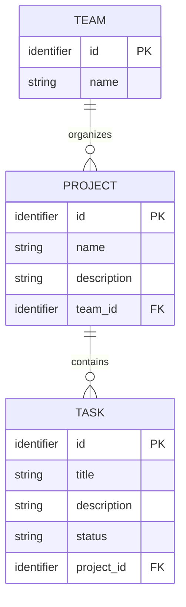

# Matriz — Modelo de Dados e Diagrama ER

## 1. Objetivo e estado do modelo

Este documento apresenta um modelo conceptual preliminar para os dados essenciais do MVP da Matriz. Baseia-se nos requisitos e histórias de utilizador atuais, considerando também os anexos de modelação como material de apoio, não como decisões aprovadas.

O âmbito confirmado envolve equipas, projetos, tarefas e acompanhamento do progresso. Os nomes de campos e tipos abaixo são propostas conceptuais; não definem uma tecnologia, um esquema físico ou uma base de dados.

## 2. Requisitos relevantes

| Referência | Necessidade |
|---|---|
| RF01 / US01 | Organizar e consultar projetos associados a uma equipa. |
| RF02 / US02 | Associar projetos a equipas de trabalho. |
| RF03 / US03 | Gerir tarefas associadas a projetos. |
| RF04 / US04 | Consultar informação de uma tarefa e identificar o projeto a que pertence. |
| RF05 / US05 / US06 | Acompanhar o progresso de projetos e tarefas. O mecanismo ainda não está definido. |

## 3. Entidades e atributos propostos

Os atributos marcados como **propostos** são escolhas mínimas de modelação para identificar e relacionar os elementos do domínio; não estão todos especificados como campos obrigatórios nos requisitos.

| Entidade | Atributo | Tipo conceptual | Identificador / restrição | Estado e justificação |
|---|---|---|---|---|
| **TEAM** (Equipa) | `id` | Identificador | PK | Identificador proposto para cada equipa. |
|  | `name` | Texto | — | Nome proposto para identificar a equipa; confirmar campos e regras. |
| **PROJECT** (Projeto) | `id` | Identificador | PK | Identificador proposto para cada projeto. |
|  | `name` | Texto | — | Nome proposto para identificar o projeto. |
|  | `description` | Texto, opcional | — | Campo ilustrativo presente no modelo do anexo; não é requisito confirmado. |
|  | `team_id` | Identificador | FK → `TEAM.id`, obrigatório segundo o pressuposto adotado | Representa a associação do projeto à equipa (RF02 / US02). |
| **TASK** (Tarefa) | `id` | Identificador | PK | Identificador proposto para cada tarefa. |
|  | `title` | Texto | — | Título proposto para identificar a tarefa (US04). |
|  | `description` | Texto, opcional | — | Campo ilustrativo presente no modelo do anexo; não é requisito confirmado. |
|  | `status` | Valor de estado ainda por definir | Obrigatoriedade e valores por confirmar | Proposta de representação do progresso da tarefa (RF05 / US06); não se definem estados nem transições. |
|  | `project_id` | Identificador | FK → `PROJECT.id`, obrigatório segundo o pressuposto adotado | Liga a tarefa ao projeto (RF03 / US03). |

Os tipos são conceptuais. O tipo físico dos identificadores, os limites dos textos, a nulabilidade definitiva e eventuais restrições de unicidade dependem de decisões futuras.

## 4. Relacionamentos e cardinalidades

| Relação | Cardinalidade proposta | Obrigatoriedade | Fundamentação / pressuposto |
|---|---|---|---|
| `TEAM` — `PROJECT` | Uma equipa pode ter zero ou muitos projetos; cada projeto pertence a uma equipa. | A associação de um projeto é obrigatória no modelo proposto. | RF02 e US02 pedem associação a equipas. **Pressuposto por validar:** um projeto pertence a uma única equipa; `constraints.md` deixa em aberto se poderá pertencer a várias. |
| `PROJECT` — `TASK` | Um projeto pode ter zero ou muitas tarefas; cada tarefa pertence a um projeto. | A associação de uma tarefa é obrigatória no modelo proposto. | RF03 e US03 definem tarefas associadas a projetos, e os critérios de US03 dizem que a tarefa deve identificar o projeto. |

Não é incluída uma relação `USER`–`TEAM` ou `USER`–`TASK`: a associação de membros a equipas e a atribuição de tarefas ainda não foram confirmadas como requisitos.

## 5. Diagrama ER

O diagrama representa as cardinalidades propostas acima. Em particular, codifica provisoriamente que cada projeto pertence a exatamente uma equipa e cada tarefa a exatamente um projeto; essas obrigatoriedades devem ser confirmadas antes de orientar a implementação.

## 6. Regras de integridade propostas

- Cada entidade tem um identificador primário único e não nulo.
- `PROJECT.team_id` referencia uma equipa existente.
- `TASK.project_id` referencia um projeto existente.
- Um projeto e uma tarefa não devem existir sem a respetiva associação, caso se confirme a cardinalidade proposta.
- Não se impõem regras de unicidade para nomes, títulos ou combinações de atributos sem confirmação do cliente.
- Não se definem valores permitidos para `TASK.status` nem regras de transição.
- Não se persiste um atributo de progresso do projeto neste modelo preliminar. O progresso pode depender das tarefas, mas ainda não foi decidido se será calculado automaticamente ou atualizado manualmente. Guardar um valor calculado sem essa decisão poderia duplicar informação e criar inconsistências.

## 7. Rastreabilidade

| Entidade / relação | Requisitos e histórias |
|---|---|
| `TEAM` e relação com `PROJECT` | RF02, US01, US02 |
| `PROJECT` | RF01, US01, US02 |
| `TASK` e relação com `PROJECT` | RF03, RF04, US03, US04 |
| `TASK.status` | RF05, US06 — proposta sujeita à definição do mecanismo e dos estados |
| Progresso de `PROJECT` | RF05, US05 — coberto como necessidade de consulta, mas sem atributo persistido até ser definido o mecanismo |

## 8. Elementos dos anexos não incorporados

O resultado de modelação e o ERD nos anexos propõem `USER`, `COMMENT`, `TASK_ASSIGNMENT`, propriedade de projetos por utilizadores e prioridades. Esses elementos não foram incluídos no modelo essencial do MVP porque os documentos atuais os deixam por validar ou não os confirmam como requisitos. O modelo do anexo também não inclui `TEAM`, apesar de a associação de projetos a equipas ser requisito P0.

Da mesma forma, não se adotam automaticamente as regras e campos ilustrativos do contrato OpenAPI — por exemplo, autenticação JWT, proprietário do projeto, estados e prioridades enumerados, comentários ou atribuições. A especificação OpenAPI é material de exercício e contém pressupostos que ainda precisam de validação.

## 9. Pressupostos e perguntas por clarificar

1. Um projeto pode pertencer a várias equipas? Se sim, a relação `TEAM`–`PROJECT` deverá ser N:M e exigirá uma entidade associativa.
2. Uma tarefa pertence sempre a um único projeto?
3. Que campos mínimos devem existir em equipas, projetos e tarefas? `name`, `title` e as descrições aqui apresentadas são propostas.
4. Como se representa o progresso da tarefa: estado, percentagem ou outro mecanismo? O campo `status` é apenas uma proposta.
5. Como se representa o progresso do projeto: cálculo a partir das tarefas ou atualização manual?
6. Utilizadores e contas fazem parte do âmbito do MVP? Em caso afirmativo, devem ser modelados a associação de utilizadores a equipas, a atribuição de tarefas e as respetivas regras de acesso?
7. Comentários, prioridades, prazos e histórico de alterações foram aprovados para o MVP?
8. Existem regras de unicidade, retenção ou eliminação de projetos e tarefas?

## 10. Revisão de coerência e normalização

- O modelo cobre os conceitos persistentes mínimos diretamente relacionados com equipas, projetos e tarefas.
- As tarefas são representadas separadamente dos projetos e ligadas por uma FK; não se repetem listas de tarefas dentro do registo de projeto.
- O progresso do projeto não é duplicado como atributo persistido enquanto o cálculo ou a atualização manual não forem decididos.
- Não foram acrescentadas entidades associativas ou funcionalidades não confirmadas.
- O modelo está sujeito a revisão após a resposta às perguntas acima; não deve ser considerado aprovado nem usado como esquema físico antes dessa validação.
